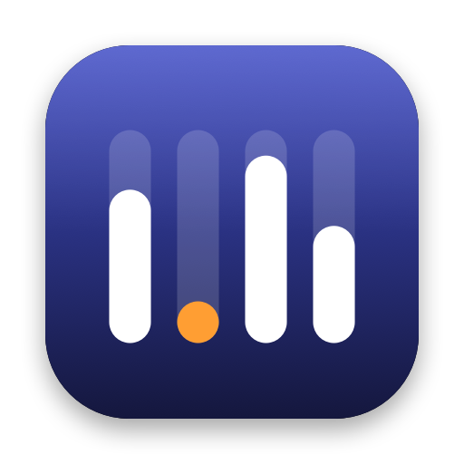
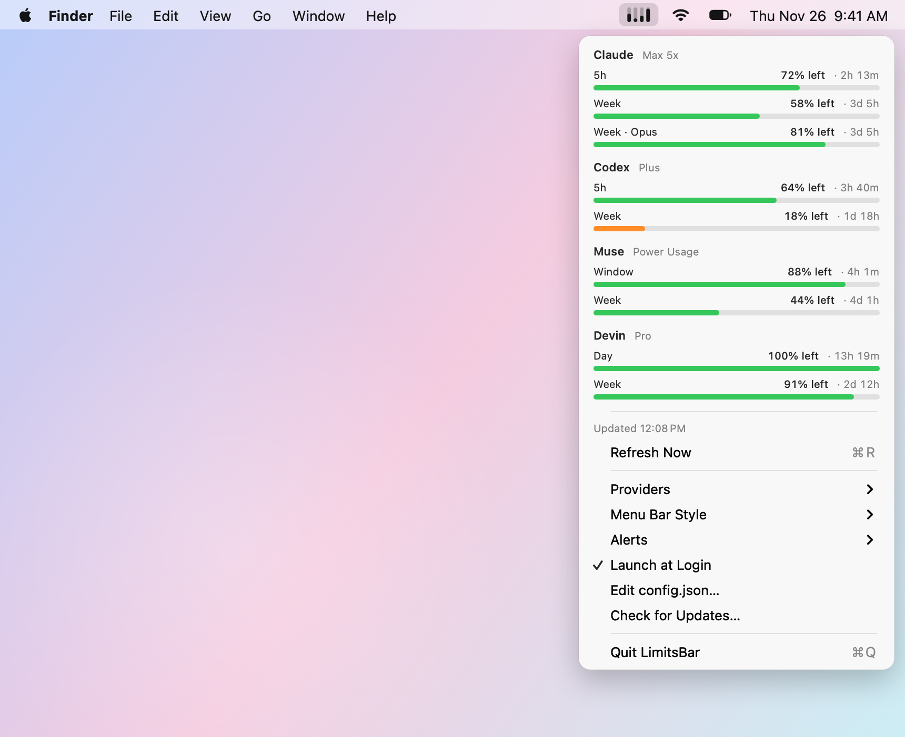
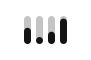
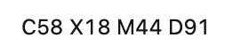
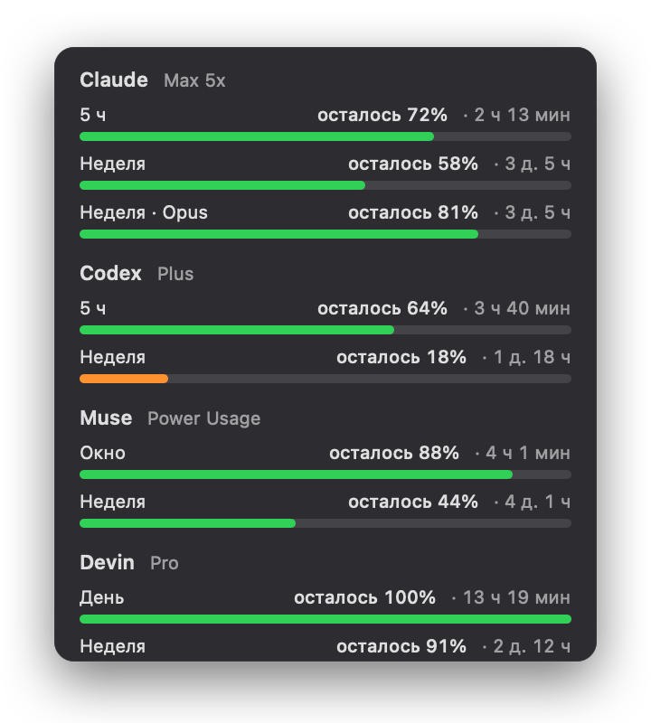
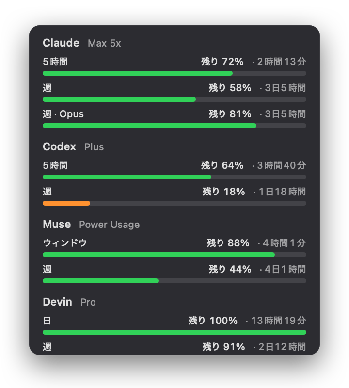
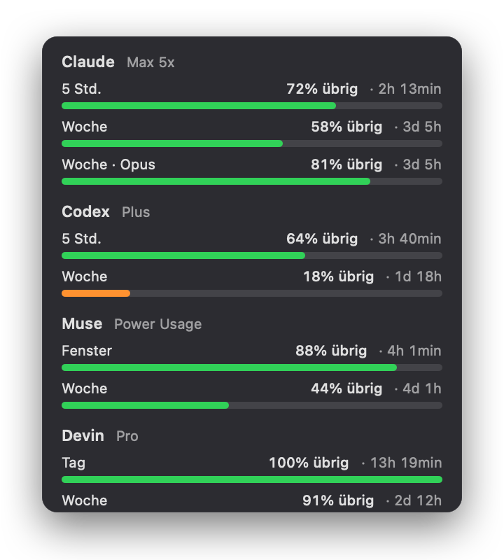

<p align="center">
  
</p>

<h1 align="center">LimitsBar</h1>

<p align="center">
  Claude, Codex, Muse and Devin limits in your Mac's menu bar.<br>
  <a href="https://github.com/rromenskyi/limits-bar/releases/latest/download/LimitsBar.dmg"><b>Download</b></a> ·
  <a href="https://rromenskyi.github.io/limits-bar/">Website</a> ·
  <a href="https://github.com/rromenskyi/limits-bar/releases">Releases</a>
</p>

<p align="center">
  <picture>
    <source media="(prefers-color-scheme: dark)" srcset="docs/assets/hero-dark.png">
    
  </picture>
</p>

A small macOS menu bar app that shows how much of your coding-agent subscription limits is left:

- **Claude** (Claude Code, Pro/Max/Team sign-in): 5-hour session, weekly, and per-model weekly limits
- **Codex** (OpenAI Codex CLI, ChatGPT sign-in): 5-hour and weekly limits
- **Muse** (Muse Code CLI): rolling window and weekly allowance
- **Devin** (Devin CLI): daily and weekly quota

Any other service can be added with a small script (see [Custom providers](#custom-providers)).
Providers whose CLI or login isn't found are hidden automatically, so you only see what you use.

## Download

Get `LimitsBar.dmg` from the [latest release](https://github.com/rromenskyi/limits-bar/releases/latest),
open it and drag LimitsBar to Applications. It is signed with a Developer ID and notarized by
Apple, and it updates itself (Sparkle). Requires macOS 14 or later.

## Using it

The menu bar shows one small level bar per provider, in the order Claude, Codex, Muse, Devin,
filled to what's left of its tightest window. Four providers take about 20 pt, so the item stays
visible next to the camera notch. Under **Menu Bar Style** you can switch to **Bars** (a letter
and two bars per provider: the short window on top, the tightest longer window below) or **Numbers**
(`C80 X12 M86 D100`). Hover the item for the numbers.

| Compact (default) | Bars | Numbers |
|:---:|:---:|:---:|
| <picture><source media="(prefers-color-scheme: dark)" srcset="docs/assets/style-compact-dark.png"></picture> | <picture><source media="(prefers-color-scheme: dark)" srcset="docs/assets/style-bars-dark.png"></picture> | <picture><source media="(prefers-color-scheme: dark)" srcset="docs/assets/style-numbers-dark.png"></picture> |

Click the item, with either button, for the menu: every window with how much is left and when it
resets, then **Refresh Now**, **Providers**, **Menu Bar Style**, **Alerts**, **Launch at Login**,
**Edit config.json…**, **About LimitsBar** (links, sponsor page, licenses), **Check for Updates…**, **Automatic Updates** and **Quit**. Release builds check for updates once a day; **Automatic Updates** turns that off or lets updates download and install by themselves.

### Alerts

LimitsBar sends a notification when a window drops to 20% and again at 5% (change the levels in
**Alerts**). Each notification has two actions: **Got It** dismisses it, and **Don't Remind
Again** mutes that window (for example Codex · Week) for good. **Alerts → Unmute All** brings
muted ones back. An alert fires once per crossing and re-arms when the window resets.

To keep alerts on screen until you act on them, set LimitsBar's notification style to **Alerts**
in System Settings → Notifications.

### Languages

English, Russian, Ukrainian, German, French, Spanish, Brazilian Portuguese, Japanese, Simplified
Chinese and Korean, following your macOS language.

<p>
  
  
  
</p>

## How it works

LimitsBar has no logins of its own. It reuses the credentials the vendor CLIs already keep on your
Mac and calls the same usage endpoints those CLIs call:

| Provider | Credentials read from | Request |
|---|---|---|
| Claude | login keychain item `Claude Code-credentials` (via `/usr/bin/security`), or `~/.claude/.credentials.json` | `GET api.anthropic.com/api/oauth/usage` |
| Codex | `~/.codex/auth.json` (`$CODEX_HOME`) | `GET chatgpt.com/backend-api/wham/usage` |
| Muse | none; runs `muse usage --json` | handled by the CLI |
| Devin | `~/.local/share/devin/credentials.toml` | `GetUserStatus` on the server named in that file |

Each token goes only to its own vendor. Nothing is stored, logged, or sent anywhere else. The
only other network request is the update check against this repository's releases.

LimitsBar never refreshes tokens itself. A refresh can rotate the refresh token and sign the CLI
out, so when a token has expired the row shows as stale until you next use that CLI. (For Muse,
LimitsBar runs `muse usage`, and the Muse CLI manages its own sign-in as it always does.)

The endpoints are unofficial and undocumented. A vendor can change them at any time, and the
affected row then shows an error while the others keep working.

Usage is checked every 5 minutes, and when you open the menu if the numbers are older than two
minutes. If a vendor answers HTTP 429, that provider is left alone for 10 minutes, doubling on
each further 429 up to an hour, and its last numbers stay on screen.

## Configuration

Menu choices are saved to `~/.config/limits-bar/config.json` (`$XDG_CONFIG_HOME` is respected).
You can also edit the file by hand; it is re-read on every refresh. All fields are optional:

```json
{
  "menuBar": "compact",
  "editor": "Sublime Text",
  "disabled": ["devin"],
  "alerts": { "enabled": true, "thresholds": [20, 5], "muted": ["codex/Week"] },
  "custom": [
    { "id": "example", "name": "Example", "tag": "E",
      "command": ["~/bin/example-quota"], "timeout": 30 }
  ]
}
```

- `menuBar`: `"compact"` (default), `"bars"` or `"numbers"`
- `editor`: the app **Edit config.json…** opens, as a name (`"Sublime Text"`), bundle id or path.
  Without it LimitsBar picks an installed code editor (VS Code, Cursor, Zed, Sublime Text, BBEdit,
  CotEditor, Nova, TextMate), then your plain-text editor, rather than the `.json` default, which
  is often Xcode
- `disabled`: provider ids to hide (`claude`, `codex`, `muse`, `devin`, or a custom id)
- `alerts`: `enabled` (default `true`), `thresholds` in percent left (default `[20, 5]`), and
  `muted` windows as `"provider/Window"`
- `custom`: extra providers, described below

## Custom providers

A custom provider is any command that prints usage JSON. `command` is the program and its
arguments; `~` is expanded, and a bare name is looked up on `PATH`. The output looks like this:

```json
{
  "plan": "Pro",
  "windows": [
    { "label": "Day",  "remainingPercent": 64, "resetsAt": "2030-01-01T00:00:00Z" },
    { "label": "Week", "usedPercent": 30,      "resetsAt": 1893456000 }
  ]
}
```

Each window takes `remainingPercent` or `usedPercent`, and `resetsAt` as an ISO 8601 string or
unix seconds. Print `{"error": "..."}` to show an error. List windows shortest first: in the
Bars style the first one is the top bar. See [`examples/custom-provider.sh`](examples/custom-provider.sh).

## Building from source

Requires Swift 6 (Xcode 16 or later).

```sh
git clone https://github.com/rromenskyi/limits-bar.git
cd limits-bar
./scripts/build-app.sh            # build/LimitsBar.app, ad-hoc signed, no auto-update
open build/LimitsBar.app
```

Other commands:

```sh
swift test
swift run LimitsBar --dump              # print normalized usage as JSON
swift run LimitsBar --snapshot out.png  # render the menu rows and the menu bar item to PNGs
```

Releases are described in [RELEASING.md](RELEASING.md). The website lives in `docs/`; its
screenshots come from demo data (`LIMITSBAR_DEMO=1`, no real accounts):

```sh
./scripts/build-app.sh
./scripts/site-captures.sh build/site-raw
swift scripts/site-compose.swift build/site-raw docs/assets
swift scripts/make-icon.swift      # app icon and site icons
```

## Adding a provider

For a built-in provider, implement `UsageProvider` in `Sources/LimitsBarCore/Providers/`. Return
windows as remaining percent with an optional reset date, then register it in
`Providers.builtIns()` and `ProviderID.builtIns`. User-facing strings go through `L(...)` and
need an entry in every `Resources/Localization/*.lproj/Localizable.strings` (a test checks this).
Pull requests for other services are welcome, but please test against a real account. For a quick
local addition, use a custom provider instead.

## License

MIT, see [LICENSE](LICENSE). Third-party software shipped in the app (Sparkle and what it bundles)
is listed with its licenses in [THIRD_PARTY_NOTICES.md](THIRD_PARTY_NOTICES.md); the app shows the
same text under **About LimitsBar**. If a dependency changes, regenerate it with
`./scripts/make-notices.sh THIRD_PARTY_NOTICES.md` (CI checks it).

Claude, Codex, Devin and Muse are trademarks of their respective owners. LimitsBar is an
independent project and is not affiliated with or endorsed by them.

If LimitsBar is useful to you, you can [sponsor it on GitHub](https://github.com/sponsors/rromenskyi).
